# GS2---CPAD

# Problema e público

O Território Preditivo é um app mobile que antecipa chuva forte, calor extremo e anomalias de consumo de água e energia no território. Hoje esses eventos costumam ser percebidos pela gestão pública só depois do dano: alagamentos sem aviso, vazamentos que duram dias e picos de demanda que sobrecarregam a rede. O público são os gestores públicos (Defesa Civil e secretarias de meio ambiente, saneamento e energia), que acompanham os indicadores e decidem o que fazer, e os cidadãos, que registram ocorrências de forma anônima. O benefício social esperado é avisar domicílios antes de alagamentos, abrir pontos de hidratação em dias de calor extremo e detectar vazamentos cedo; o app mostra isso no indicador "domicílios com aviso antecipado".

# Território Preditivo
 

 
> Painel mobile que antecipa chuva forte, calor extremo e anomalias de consumo de água e energia, para apoiar a decisão de gestores públicos.
 
## Problema e público
 
Chuvas fortes, calor extremo e consumo anômalo de água e energia costumam ser percebidos pela gestão pública só depois do dano: alagamentos sem aviso, vazamentos que duram dias e picos de demanda que sobrecarregam a rede.
 
- **Problema que o app antecipa:** alagamentos, ondas de calor, vazamentos e altas sustentadas de consumo no território.
- **Público:** gestores públicos (Defesa Civil e secretarias de meio ambiente, saneamento e energia), que acompanham os indicadores e decidem o que fazer; e cidadãos, que registram ocorrências de forma anônima.
- **Território:** centro de São Paulo (clima real); água e energia sintéticos para 4.200 domicílios.
- **Impacto social esperado:** avisar domicílios antes de alagamentos, abrir pontos de hidratação em dias de calor extremo e detectar vazamentos cedo. O app exibe um indicador de benefício social: **domicílios com aviso antecipado** (estimativa).
 
## Integrantes
 
| Nome completo | RM |
|---|---|
| Caio Castelão Carminato | RM563630 |
| Guilherme Vasques Tamai | RM563276 |
| Vitor Komura de Freitas | RM563694 |
 
## Demonstração visual
 
| Consentimento | Visão geral | Dashboard de água |
|---|---|---|
| 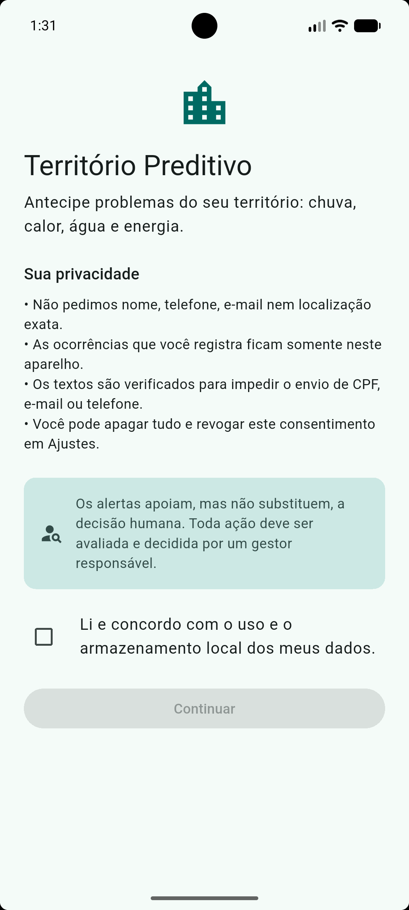 | 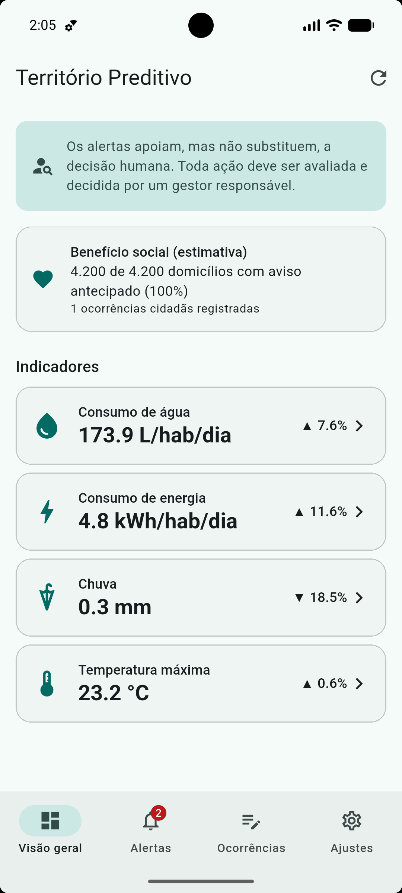 | 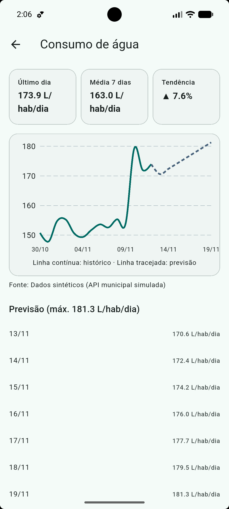 |
 
| Dashboard de chuva | Dashboard de temperatura | Alertas |
|---|---|---|
| 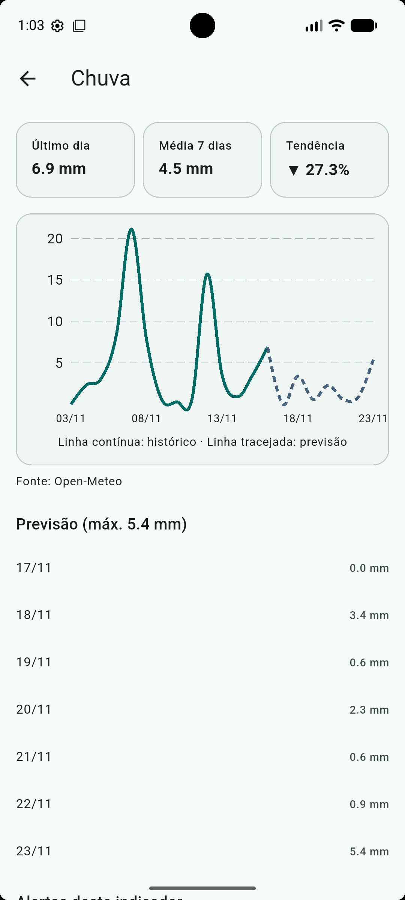 | 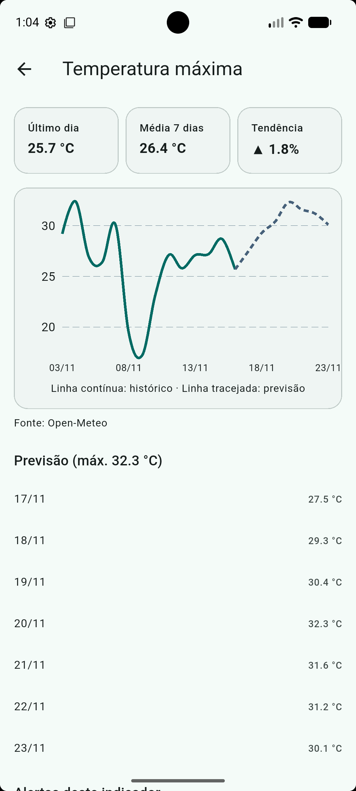 | 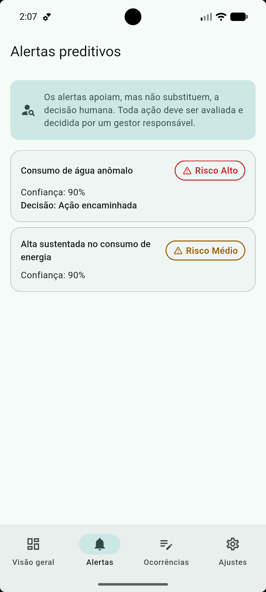 |
 
| Detalhe do alerta | Decisão do gestor registrada | Ocorrências |
|---|---|---|
| 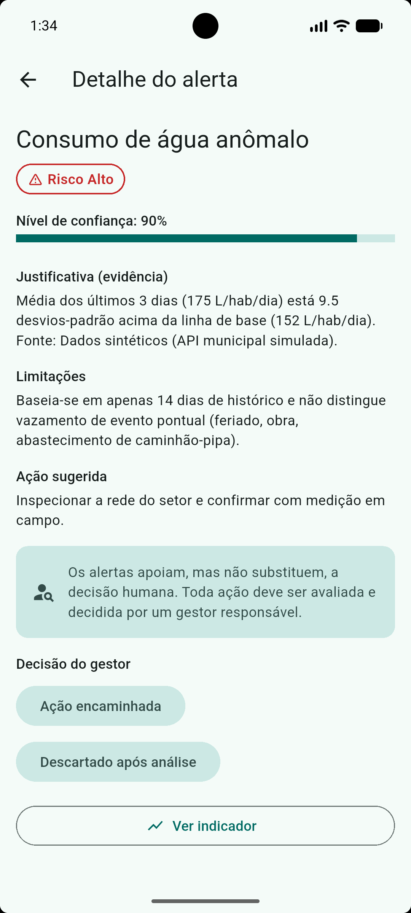 | 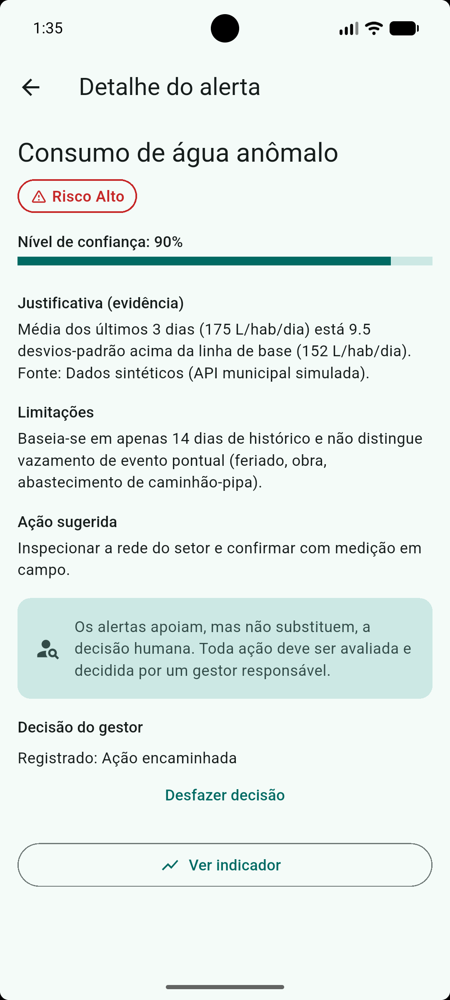 | 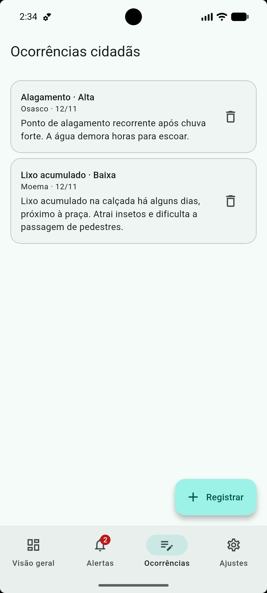 |
 
| Formulário de ocorrência | Ajustes | Modo escuro |
|---|---|---|
| 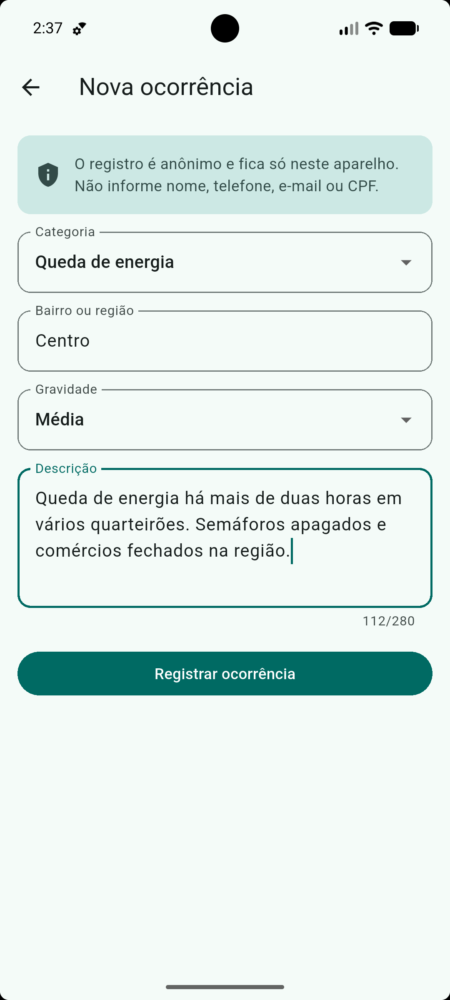 | 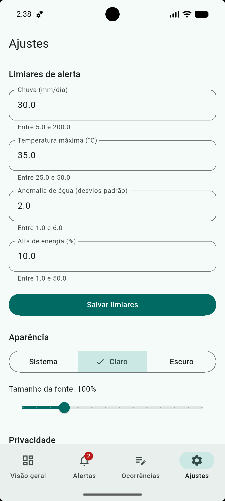 | 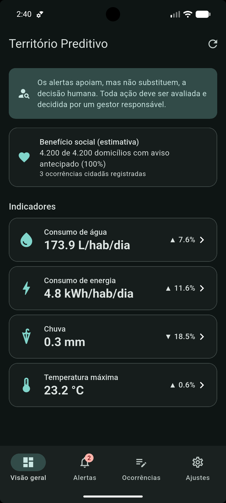 |
 
| Fonte ampliada |
|---|
| 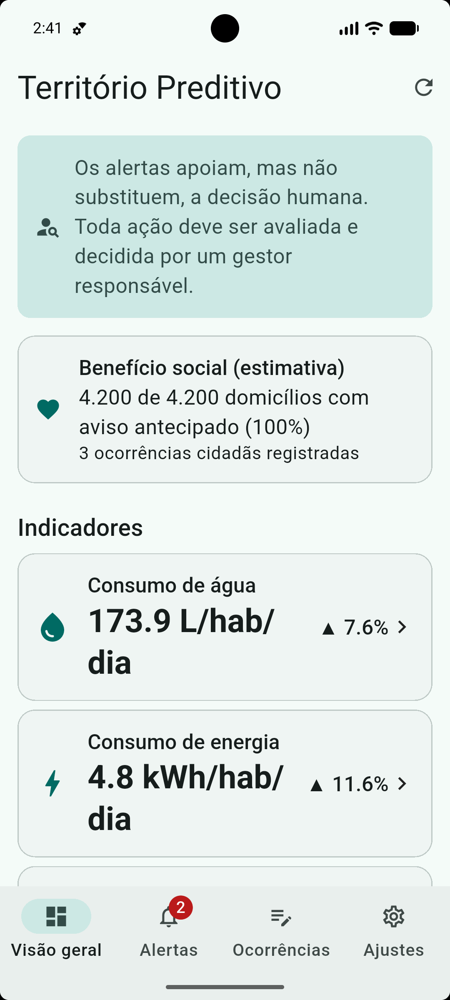 |
 
## Funcionalidades
 
- [x] Rotas nomeadas e passagem de parâmetros (visão geral → indicador → alerta)
- [x] 4 dashboards (água, energia, chuva, temperatura) com histórico, previsão e tendência
- [x] Alertas por regras com justificativa, nível de confiança e limitações
- [x] Aviso visível de que a decisão final é humana + registro da decisão do gestor
- [x] Estado global (Provider) com carregamento, erro e lista vazia
- [x] API real (Open-Meteo) + API municipal simulada, com cache offline
- [x] Formulários com validação (ocorrência cidadã e limiares de alerta)
- [x] Consentimento, anonimização e opção de apagar todos os dados
- [x] Indicador de benefício social (domicílios com aviso antecipado)
- [x] Modo escuro, fonte ajustável e rótulos para leitores de tela
- [x] Testes automatizados (regras de alerta, validadores e widgets)
 
## Dados e alertas
 
- **Fontes:** clima real via [Open-Meteo](🌤️ Free Open-Source Weather API | Open-Meteo.com) (API pública, sem chave); água e energia são **sintéticos** (API municipal simulada, determinísticos).
- **Como os alertas são gerados:**
  - *Chuva e temperatura:* a previsão dos próximos 7 dias passa do limiar configurado. A confiança cai 8 p.p. por dia de horizonte (90% no dia 1, mínimo de 40%).
  - *Água:* z-score da média dos últimos 3 dias contra a linha de base dos dias anteriores. Confiança = 0,5 + 0,08 · z (entre 50% e 90%).
  - *Energia:* crescimento previsto por regressão linear sobre a média histórica. Confiança = R² da regressão (entre 30% e 90%).
- **Nível de risco:** baixo, médio ou alto conforme o quanto o valor excede o limiar. O nível sempre aparece em texto, não só em cor.
- **Benefício social:** o número de domicílios por alerta é uma **estimativa com premissas fixas** (ex.: 4.200 domicílios no território simulado), não uma medição.
- **Limitações e vieses:** apenas 14 dias de histórico; a regressão linear ignora sazonalidade, temperatura e feriados; o clima vem de um único ponto do município (microclimas e ilhas de calor não aparecem); dados de água e energia são sintéticos e não refletem a realidade.
- **Quando as previsões não são confiáveis:** horizontes acima de 3–4 dias, histórico curto ou ruidoso, eventos atípicos (feriados, obras, caminhão-pipa) e dados de clima em cache desatualizados (o app avisa quando está offline).
- **Decisão humana:** o app nunca decide sozinho. O gestor aceita ou descarta cada alerta, e a decisão fica registrada.
 
## Privacidade e inclusão
 
- **Privacidade (LGPD):** o app não coleta nome, contato nem localização exata. As ocorrências são anônimas e ficam salvas só no aparelho. A validação bloqueia CPF, e-mail e telefone no texto livre. Há tela de consentimento no primeiro acesso e o botão "Apagar meus dados e revogar consentimento" em Ajustes.
- **Acessibilidade:** rótulos `Semantics` nos elementos interativos, nível de risco sempre em texto (não só cor), cores com contraste adequado em tema claro e escuro, tamanho de fonte ajustável (85% a 150%) e respeito à fonte do sistema.
- **Responsividade:** largura do conteúdo limitada em telas grandes e listas roláveis em telas pequenas.
- **Tamanhos de tela testados:** emulador Android Pixel 7 (Android 17) e Chrome em largura de desktop, além da fonte ampliada em até 150%.
 
## Tecnologias e decisões técnicas
 
| Escolha | Justificativa |
|---|---|
| Flutter + Material 3 | Multiplataforma, componentes acessíveis e tema único |
| provider | Simples e suficiente para o estado global (`ChangeNotifier`) |
| http | Consumo da API REST com timeout e queda para o cache |
| shared_preferences | Persistência leve de cache, ocorrências, decisões e limiares |
| fl_chart | Gráficos de linha com histórico e previsão tracejada |
| Navigator + rotas nomeadas | Sem dependência extra; `onGenerateRoute` centralizado |
| Open-Meteo | Clima real, gratuito e sem chave de API |
 
**Estrutura:** `lib/core/` (tema, widgets reutilizáveis, rotas, validadores), `lib/models/`, `lib/services/` (API, motor de alertas, storage), `lib/state/` (estado global) e `lib/screens/`. Estado local (campos de formulário, aba atual) fica nos próprios widgets; estado global (indicadores, alertas, consentimento, decisões) fica no `AppState`.
 
## Como executar
 
Pré-requisito: [Flutter](Install and set up Flutter) estável (3.35 ou superior) e um emulador Android ou dispositivo conectado.
 
```bash
git clone GitHub - GuilhermeTamai/GS2---CPAD
cd GS2---CPAD
flutter pub get
flutter run
```
 
Para rodar os testes: `flutter test`.
 
Não há chaves de API nem variáveis de ambiente: a Open-Meteo é pública. O app precisa de internet só na primeira carga; depois usa o último clima salvo.
 
## Vídeo
 
https://www.youtube.com/shorts/_4s8jGDnRp8
 
## Licença
 
Projeto acadêmico — FIAP, Global Solution 2026.2.
🌤️ Free Open-Source Weather API | Open-Meteo.com
Open-Source ☀️ Weather API with free access for non-commercial use. No API Key required ✅. Accurate weather forecasts for any location. Open-Meteo provides high-resolution open data ranging from 1 ...
 
